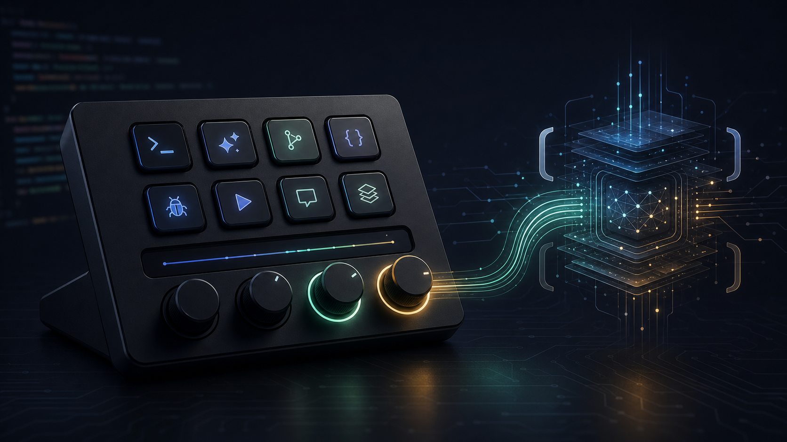
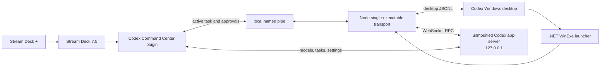

<p align="center">
  
</p>

<h1 align="center">Codex Command Center for Stream Deck +</h1>

<p align="center">
  A direct, windowless hardware control surface for the Codex Windows app—built for an ordinary Elgato Stream Deck +.
</p>

<p align="center">
  <a href="https://github.com/kyleboddy/codex-streamdeck/actions/workflows/ci.yml"></a>
  <a href="LICENSE"></a>
  
  
  
  
</p>

> [!IMPORTANT]
> This is an unofficial interoperability project. It relies on version-sensitive Codex desktop behavior and is not affiliated with or endorsed by OpenAI, Elgato, or Work Louder. Read the [compatibility notes](#-compatibility) before installing.

Inspired by the [OpenAI × Work Louder Codex Micro](https://openai.com/supply/co-lab/work-louder/), this project turns a Stream Deck + into a focused Codex command center. The keys act on the current task, while two rotary encoders choose live Codex models and reasoning effort. It uses Codex's own app-server protocol—no synthetic hotkeys, UI scraping, USB emulation, or Stream Deck editor automation.

## ✨ What it does

- Controls the active Codex task without stealing keyboard focus.
- Rotates through the model catalog reported by the running Codex app-server.
- Selects reasoning effort from Light through Ultra when supported by a model.
- Responds to approval requests on the desktop connection that received them.
- Opens Codex's native new-task composer in the current workspace.
- Keeps the launcher, app-server, MCP tools, and helper processes off the desktop taskbar.
- Installs a ready-made Stream Deck + profile with unique production artwork.
- Leaves two key slots and two encoders intentionally open for later customization.
- Includes a one-command diagnostic report and a reversible shim-disable path.

## 🎛️ Default hardware layout

| Position | Control | Behavior |
| --- | --- | --- |
| Key 1 | **New Task** | Opens Codex's native empty composer for the active workspace. |
| Key 2 | **Review Changes** | Starts an inline review of uncommitted changes in the active task. |
| Key 3 | **Approve** | Accepts the newest pending approval request associated with the desktop connection. |
| Key 4 | **Decline** | Declines that pending request. |
| Key 5 | **Stop** | Interrupts the active Codex turn. |
| Key 6 | **Fork** | Forks the active task and opens the new task. |
| Keys 7–8 | **Custom slots** | Blank by default; configured in one local JSON file. |
| Dial 1 | **Brainpower** | Light, Medium, High, Extra High, Max, Ultra. Push resets to High. |
| Dial 2 | **Model** | Rotates through the live model catalog. Push refreshes and selects the preferred model. |
| Dials 3–4 | **Open** | Deliberately unused. |

Every control above, plus **Skills** and **Settings**, remains available in the Stream Deck action list. You can drag those actions into a custom profile without changing code.

The model dial is intentionally dynamic: it calls `model/list` instead of shipping a stale model table. The Brainpower dial updates both durable user configuration and the active task's live settings. If a selected effort is unsupported by the current model, the controller selects the first live model advertising that effort.

## 🧠 Architecture



Codex desktop honors a `CODEX_CLI_PATH` override. The installer points it to a small `.NET` Windows-subsystem launcher, which starts a Node single-executable transport without creating a console window. That transport delegates to an exact copy of the Codex CLI packaged with the installed app, starts its app-server on loopback, and bridges the desktop's JSONL connection to WebSocket RPC.

The Stream Deck plugin joins the same app-server as a second client. A local named pipe preserves the few operations tied to the desktop connection itself: active-task tracking, approval responses, review injection, and turn interruption. The original packaged Codex executable is never patched or overwritten.

For the evidence, failed approaches, protocol map, process-containment work, and limitations, see the **[reverse-engineering writeup](docs/reverse-engineering.md)**.

## 🚀 Install locally

### Prerequisites

- Windows 10 or 11
- Elgato Stream Deck + and Stream Deck software 7.5
- The Codex Windows app
- [Node.js](https://nodejs.org/) 24 or newer
- [.NET SDK](https://dotnet.microsoft.com/download) 10

Clone the repository and run the local installer from PowerShell:

```powershell
git clone https://github.com/kyleboddy/codex-streamdeck.git
Set-Location codex-streamdeck
npm run install:local
```

> [!NOTE]
> The installer restarts Stream Deck and schedules a windowless Codex restart so the new transport takes effect. Save any unfinished input first. Existing `%LOCALAPPDATA%\CodexDeck\deck-config.json` customizations are preserved.

To install while leaving the current Codex process alone:

```powershell
powershell -NoProfile -ExecutionPolicy Bypass -File scripts\install-local.ps1 -SkipCodexRestart
```

The integration becomes active the next time Codex starts.

### What the installer changes

The installer:

1. Locates the installed Codex Windows package and copies its exact CLI into a versioned user-local runtime directory.
2. Builds and smoke-tests the windowless launcher and single-executable transport.
3. Builds the Stream Deck profile and production image sizes.
4. Installs the plugin and profile under Elgato's normal roaming-data directories.
5. Sets four user-scoped environment variables:
   - `CODEX_CLI_PATH`
   - `CODEX_DECK_TRANSPORT_PATH`
   - `CODEX_DECK_REAL_CLI`
   - `CODEX_DECK_SERVER_URL`
6. Restarts the applications unless a skip switch is supplied.

Runtime state, configuration, and logs live under `%LOCALAPPDATA%\CodexDeck`. No cloud service, API key, or separate OpenAI session is required.

## 🔧 Configure the blank keys

Edit `%LOCALAPPDATA%\CodexDeck\deck-config.json`. A slot can remain blank, open a URI, or invoke one of the built-in action names: `new-task`, `review`, `approve`, `decline`, `stop`, `fork`, `skills`, or `settings`.

```json
{
  "blanks": {
    "blank1": {
      "title": "Docs",
      "type": "uri",
      "value": "https://developers.openai.com/codex/"
    },
    "blank2": {
      "title": "Skills",
      "type": "action",
      "value": "skills"
    }
  }
}
```

Restart Stream Deck after changing slot titles. Invalid values and recursive custom actions are rejected with Stream Deck's alert indicator.

## 🛠️ Develop and package

Install dependencies:

```powershell
npm ci --ignore-scripts
npm --prefix com.driveline.codex-command-center.sdPlugin ci --omit=dev --ignore-scripts
```

Useful commands:

| Command | Purpose |
| --- | --- |
| `npm run build` | Generate assets/profile and build the transport plus launcher. |
| `npm test` | Run controller, feedback, layout, and artwork tests. |
| `npm run validate` | Validate the plugin with Elgato's CLI. |
| `npm run pack` | Create `dist/*.streamDeckPlugin`. |
| `npm run diagnose` | Inspect the local install, processes, device, models, and effort catalog. |
| `npm run install:local` | Build, install, and activate the complete integration. |

GitHub Actions runs the portable tests, Elgato validation, and plugin packaging on Windows. A full integration build remains a local hardware test because it needs the installed Codex package, its matching CLI, and a Stream Deck + profile.

> [!WARNING]
> The `.streamDeckPlugin` artifact contains the Elgato plugin and profile, but it is not a standalone Codex shim installer. Direct model, reasoning, task, and approval control still requires `npm run install:local` on the target Windows machine.

## 🧪 Verification

Before submitting a change:

```powershell
npm test
npm run validate
npm run pack
```

For transport, launcher, model, effort, or approval changes, also run:

```powershell
npm run install:local
npm run diagnose
```

Then verify the affected controls on physical hardware. Do not commit diagnostics containing private workspace paths, task content, account details, or device serials.

## 🛟 Disable or recover

To remove the user-level shim variables and relaunch the normally packaged Codex app:

```powershell
powershell -NoProfile -ExecutionPolicy Bypass -File scripts\disable-shim.ps1
```

This does not uninstall Codex or alter its packaged CLI. Run `npm run install:local` again to reactivate the integration.

After a Codex desktop update, rerun the installer so the user-local real-CLI copy stays aligned with the application. If behavior changes after an update, capture redacted `npm run diagnose` output and open a [bug report](https://github.com/kyleboddy/codex-streamdeck/issues/new/choose).

## 📦 Compatibility

The last exhaustive local verification snapshot was taken on **July 15, 2026** with:

- Codex Windows app `26.707.9981.0`
- Codex CLI `0.144.2`
- Stream Deck software `7.5.0.22885`
- Elgato Stream Deck +

The app-server model catalog and supported effort levels are discovered at runtime, so the hardware can follow catalog changes without a plugin release. The `CODEX_CLI_PATH` override, desktop deep links, and some desktop-connection behavior are empirically discovered and may change between Codex releases.

## 🔬 Research and project docs

- [Reverse engineering Codex desktop for a Stream Deck + control surface](docs/reverse-engineering.md)
- [Contributing guide](CONTRIBUTING.md)
- [Security policy and local threat model](SECURITY.md)
- [Changelog](CHANGELOG.md)

Primary external references include the [Codex app-server documentation](https://developers.openai.com/codex/app-server), [OpenAI × Work Louder Co-Lab announcement](https://openai.com/supply/co-lab/work-louder/), and [Elgato profile SDK guide](https://docs.elgato.com/streamdeck/sdk/guides/profiles/).

## 🤝 Contributing

Issues and pull requests are welcome. Please read [CONTRIBUTING.md](CONTRIBUTING.md), keep protocol claims tied to reproducible evidence, and preserve the safety boundary around approvals and credentials.

## 📄 License and trademarks

Licensed under the [Apache License 2.0](LICENSE).

Codex and OpenAI are trademarks of OpenAI, L.L.C. Stream Deck and Elgato are trademarks of Corsair Memory, Inc. Work Louder is a trademark of Work Louder Inc. All product names are used only to describe interoperability. This repository is an independent community project.
