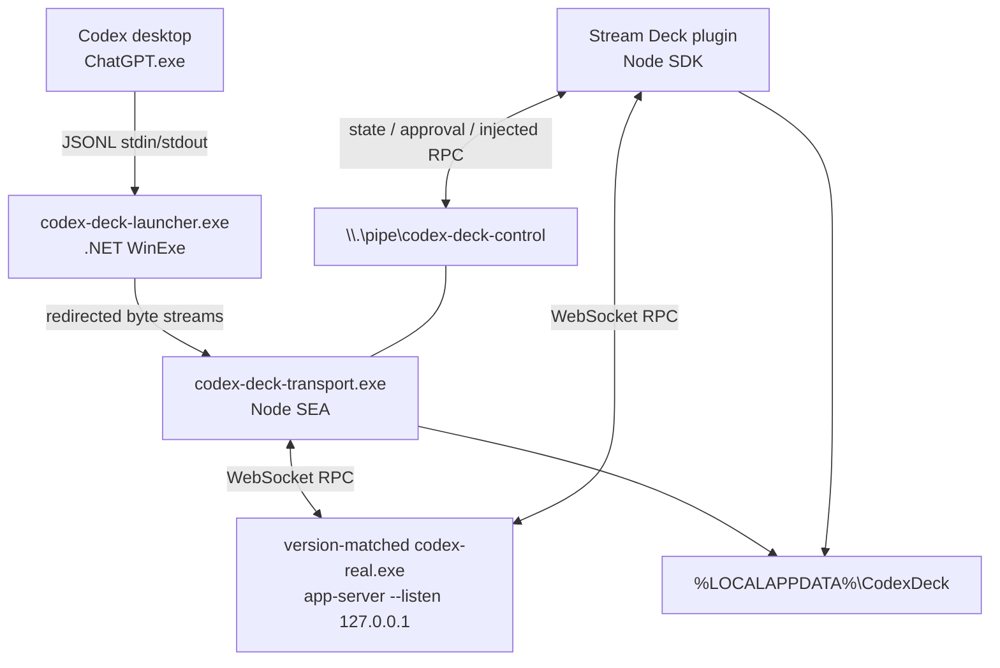
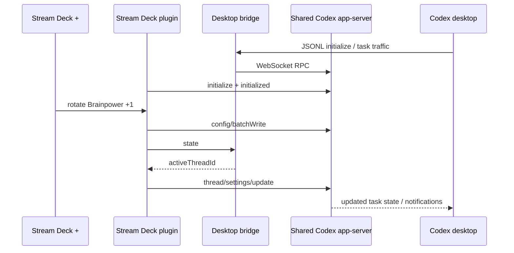

# Reverse engineering Codex desktop for a Stream Deck + control surface

_Research record and implementation rationale — July 15, 2026_

> [!IMPORTANT]
> This document describes a version-sensitive interoperability investigation. Observations from installed binaries are labeled as empirical evidence or inference; they are not promises of a stable OpenAI interface. The project does not bypass authentication, suppress approval requirements, spoof first-party hardware, or modify the packaged Codex application.

## Abstract

The goal was to reproduce the useful behavior of the OpenAI × Work Louder Codex Micro on an ordinary Elgato Stream Deck +: dedicated task actions, live model selection, and a physical reasoning-effort dial. The constraint was equally important: the integration had to act on Codex directly, without keyboard macros, mouse automation, window scraping, visible helper terminals, or a custom kernel driver.

The resulting design is a shared Codex app-server architecture. Codex desktop is launched through a windowless compatibility shim that preserves its expected stdin/stdout transport while starting the unmodified, version-matched Codex CLI as a loopback WebSocket app-server. The desktop and Stream Deck plugin become two initialized clients of that same server. A small local named pipe carries only connection-bound operations, chiefly approval responses and active-task state.

This design followed five decisive findings:

1. Codex desktop supports a `CODEX_CLI_PATH` override.
2. The packaged CLI can expose the same app-server over loopback WebSocket.
3. Live task settings are process-local; a second, independent app-server cannot mutate a task already loaded by the desktop.
4. Approval requests must be answered on the client connection that received them.
5. Starting the real CLI in the launcher's inherited headless console prevents later MCP descendants from allocating visible terminal windows.

## Contents

- [Scope and evidence standard](#scope-and-evidence-standard)
- [Research environment](#research-environment)
- [What the announced hardware appears to do](#what-the-announced-hardware-appears-to-do)
- [Investigation methodology](#investigation-methodology)
- [Experiments and findings](#experiments-and-findings)
- [Final architecture](#final-architecture)
- [Protocol map](#protocol-map)
- [Model and Brainpower behavior](#model-and-brainpower-behavior)
- [Approval safety](#approval-safety)
- [Windowless process containment](#windowless-process-containment)
- [Rejected approaches](#rejected-approaches)
- [Validation](#validation)
- [Security and trust boundaries](#security-and-trust-boundaries)
- [Compatibility risks](#compatibility-risks)
- [Reproducing the research](#reproducing-the-research)
- [Primary references](#primary-references)

## Scope and evidence standard

The investigation was limited to software and hardware locally owned by the researcher and public documentation/source code. It used ordinary Windows package inspection, generated app-server schemas, local process/network observation, static JavaScript archive inspection, and controlled RPC probes.

Claims in this document fall into three categories:

| Label | Meaning |
| --- | --- |
| **Documented** | Supported by a linked first-party specification or source repository. |
| **Observed** | Reproduced against the versions in the research snapshot. |
| **Inferred** | A reasonable explanation consistent with observed artifacts, but not publicly specified. |

No attempt was made to recover credentials, intercept remote TLS traffic, defeat application signing, or impersonate Codex Micro at the USB layer. Device serial numbers and account identifiers are intentionally excluded from this repository.

## Research environment

| Component | Research snapshot |
| --- | --- |
| Date | 2026-07-15 |
| Operating system | Windows 11 x64 |
| Codex Windows package | `26.707.9981.0` |
| Packaged Codex CLI | `0.144.2` |
| Stream Deck software | `7.5.0.22885` |
| Hardware | Elgato Stream Deck +, model `20GBD9901` |
| Stream Deck SDK | SDK v2 manifest, Node runtime 20 |
| Elgato CLI | `1.7.4` |
| Build Node.js | 24 or newer |
| Launcher runtime | .NET 10, Windows GUI subsystem |

The version table is evidence, not a compatibility guarantee. Codex app-server schemas were generated from the CLI shipped with this exact desktop package instead of copied from an older SDK snapshot.

## What the announced hardware appears to do

OpenAI describes Codex Micro as a purpose-built Work Louder control surface with core actions, live status lighting, and a Brainpower dial that changes reasoning. That public description establishes the behavior, but it does not publish a third-party USB protocol.

Static inspection of the installed Codex desktop archive found Work Louder device-kit code and renderer-side HID event routing. The conservative inference is that first-party hardware events are decoded inside the desktop renderer and mapped directly to application state. This is consistent with a low-latency integrated product, but the exact report format is not documented publicly.

The project therefore recreates the interaction at Codex's application-protocol boundary. It does **not**:

- advertise a Work Louder vendor/product identity;
- imitate undisclosed HID reports;
- patch the Codex renderer;
- install a filter driver; or
- claim compatibility with first-party device firmware.

Source: [OpenAI × Work Louder Co-Lab announcement](https://openai.com/supply/co-lab/work-louder/).

## Investigation methodology

### 1. Enumerate the physical device and software stack

Windows PnP and process inventory established that the Stream Deck + was connected locally and owned by Elgato's software rather than a remote USB-forwarding layer. Representative read-only checks were:

```powershell
Get-PnpDevice -PresentOnly |
    Where-Object FriendlyName -Match 'Stream Deck|Elgato' |
    Format-Table Status, Class, FriendlyName, InstanceId

Get-Process StreamDeck, ChatGPT -ErrorAction SilentlyContinue |
    Select-Object Id, ProcessName, Path, MainWindowTitle
```

The hardware model identifier was retained for profile matching; the per-device serial/UUID was used only during local installation and never recorded in research output.

### 2. Inspect Elgato's supported extension boundary

Elgato's SDK supports plugins containing action definitions, artwork, encoder feedback layouts, and installable device profiles. The profile manifest can target Stream Deck + (`DeviceType: 7`) and auto-install through the plugin manifest. This made an ordinary SDK v2 plugin the correct owner of keys, dials, and touch-strip feedback.

The connected device profile was copied as a build input, sanitized of machine-specific identity, and populated with six actions, two blank keys, two encoders, and two deliberately unused encoders. At install time, the script injects only the connected device UUID into the installed copy.

Elgato's Stream Deck MCP integration was also evaluated. It exposes deck actions as tools an AI client can call—useful for “Codex operates the deck.” It does not make dial rotations a native input stream for Codex model/task settings. The MCP integration can remain enabled, but it is orthogonal to “deck operates Codex.”

Sources: [Elgato profile guide](https://docs.elgato.com/streamdeck/sdk/guides/profiles/), [dial actions](https://docs.elgato.com/streamdeck/sdk/guides/dials/), and [Stream Deck MCP setup](https://www.elgato.com/ww/en/explorer/products/stream-deck/sd-mcp-setup/).

### 3. Establish Codex's public protocol boundary

Codex app-server is the protocol layer used to build rich clients. Its lifecycle includes initialization, tasks/threads, turns, approvals, streamed notifications, model discovery, and configuration. The installed CLI generated matching TypeScript and JSON Schema definitions:

```powershell
codex app-server generate-ts --out .\generated\typescript
codex app-server generate-json-schema --out .\generated\json-schema
```

The generated artifacts were searched for candidate methods and then verified with live requests. The app-server uses JSON-RPC-shaped request/response messages. Stdio is JSON Lines; the investigated CLI also supports an experimental WebSocket listener. This project binds that listener to loopback only.

Source: [Codex app-server documentation](https://developers.openai.com/codex/app-server) and [openai/codex app-server source](https://github.com/openai/codex/tree/main/codex-rs/app-server).

### 4. Inspect the desktop integration contracts

The installed Microsoft Store package was located with `Get-AppxPackage OpenAI.Codex`. Read-only inspection of the Electron archive and unpacked modules established several version-specific facts:

- the desktop consults `CODEX_CLI_PATH` when selecting its CLI transport;
- the renderer registers `codex://threads/new` and `codex://threads/<id>` navigation;
- the renderer registers `codex://skills` and `codex://settings` navigation;
- Work Louder device-kit code exists in the application bundle; and
- the desktop speaks app-server over a child process's stdin/stdout.

These are **observed internal contracts**, not public stability guarantees. The implementation isolates them behind the installer/controller so future changes have a small repair surface.

### 5. Probe state ownership instead of assuming it

The most important experiments tested where live state actually resides:

1. Start app-server A for the desktop and app-server B for an external controller.
2. Load a task in A.
3. send `thread/settings/update` for that task through B.
4. Observe whether A changes.

It did not. The persisted task may be visible to both processes, but the loaded task's live settings belong to the server process managing it. This negative result invalidated the simple “plugin starts its own app-server” design.

A second probe connected two initialized clients to one WebSocket app-server. A task selected through the desktop-side bridge was visible to the peer, and a peer `thread/settings/update` was immediately reflected on the shared task. That result established the shared-server architecture.

## Experiments and findings

### Experiment A: independent app-server

**Hypothesis:** A Stream Deck plugin can start a separate Codex app-server and modify the task open in desktop.

**Result:** Rejected. The second server could read persisted records but could not change process-local live state in the desktop server.

**Design consequence:** The desktop and plugin must connect to one real app-server process.

### Experiment B: two clients, one server

**Hypothesis:** Multiple initialized WebSocket clients can share a single app-server.

**Result:** Confirmed. Task state and setting updates were visible across clients.

**Design consequence:** The Stream Deck plugin can be a normal peer for model discovery, configuration, thread reads, and thread settings.

### Experiment C: desktop JSONL-to-WebSocket bridge

**Hypothesis:** The desktop can keep its expected stdin/stdout contract while the real app-server runs as a WebSocket listener.

**Result:** Confirmed. The bridge forwarded complete newline-delimited desktop messages to WebSocket and server messages back to stdout. Initialization, task selection, notifications, and bidirectional probes passed through the final launcher.

**Design consequence:** No desktop code patch is necessary; `CODEX_CLI_PATH` can point at a compatible transport.

### Experiment D: approval routing

**Hypothesis:** The Stream Deck peer can directly answer approval requests it did not receive.

**Result:** Rejected as unsafe and connection-incompatible. Approval requests are server-initiated messages with IDs on the originating desktop connection.

**Design consequence:** The bridge observes pending approval IDs and exposes a narrow local `approve`/`decline` operation. The response is written back on the desktop connection.

### Experiment E: native new task

**Hypothesis:** Calling `thread/start` and immediately opening the returned task is equivalent to clicking New Task.

**Result:** Rejected. A task created without a submitted turn has no rollout, producing the desktop error “no rollout found for thread id …”.

**Design consequence:** New Task opens `codex://threads/new?path=<workspace>`. Codex owns creation timing and persists the task only after the user submits the first prompt. The model and effort dials still work because they persist user defaults before the composer opens.

### Experiment F: console-window containment

**Hypothesis:** Detaching the real CLI is the cleanest way to keep the app-server out of the desktop UI.

**Result:** Rejected on Windows. A detached console process could cause later Node, PowerShell, and MCP descendants to allocate visible console windows.

**Design consequence:** A `WinExe` launcher creates a headless inherited process tree and continuously pumps stdio. The real CLI is not given a separate console. Post-install inspection found zero visible descendant terminal windows.

## Final architecture

### Process topology



### Request sequence



### Component responsibilities

#### `.NET` windowless launcher

The launcher is built with `OutputType=WinExe` and targets .NET 10. It resolves `CODEX_DECK_TRANSPORT_PATH`, starts the single-executable transport with `UseShellExecute=false`, `CreateNoWindow=true`, and redirected standard streams, then pumps stdin, stdout, and stderr without interpreting protocol data.

Keeping this layer tiny has two benefits: Windows process semantics are explicit, and the Node transport can remain independently testable.

#### Node single-executable transport

The transport is packaged as a Node SEA binary. It distinguishes two cases:

- **Ordinary CLI invocation:** remove `CODEX_CLI_PATH` from the child environment and delegate unchanged arguments to the copied real CLI.
- **Desktop app-server invocation:** ensure one shared loopback app-server, bridge desktop JSONL to WebSocket, track connection-bound state, and host the named pipe.

Removing `CODEX_CLI_PATH` before delegation prevents recursive shim invocation. A user-local bootstrap lock prevents concurrent desktop launches from racing to start multiple listeners. Runtime executables are content/version named so an in-use file does not have to be overwritten during updates.

#### Shared real app-server

The installer copies the `codex.exe` packaged with the current desktop app into `%LOCALAPPDATA%\CodexDeck\runtime` and records the source package version. The copy is byte-compared before replacement. The original package is never modified.

The server listens on `ws://127.0.0.1:47812`. Loopback limits exposure to the local machine. The project does not support non-loopback binding; Codex's documentation recommends authentication and TLS when a listener is exposed beyond loopback.

#### Stream Deck plugin

The SDK v2 plugin initializes as a second app-server client. It owns:

- live model pagination and refresh;
- effort/model selection policy;
- encoder feedback and key success/error feedback;
- direct task actions;
- local custom-slot validation; and
- connection retry behavior.

The manifest declares distinct `Keypad` and `Encoder` controllers and a packaged Stream Deck + profile. Each marketplace action has unique action-list and hardware artwork; encoder feedback uses Elgato's `$B1` layout and normalized indicators.

#### Local control pipe

`\\.\pipe\codex-deck-control` has three command classes:

| Command | Purpose |
| --- | --- |
| `state` | Return the desktop bridge's current task, turn, server, and approval state. |
| `rpc` | Inject a narrowly requested RPC onto the desktop connection. Used for review and interrupt behavior that should target the observed desktop state. |
| `approve` / `decline` | Answer the newest recognized pending approval on its originating connection. |

Each client request and server response is one JSON line. The pipe is local-only and is not a general remote-control listener.

## Protocol map

The table below records the current hardware-to-protocol mapping. Payload shapes were checked against schemas generated by the installed CLI.

| Hardware intent | Operation | Important parameters / behavior |
| --- | --- | --- |
| Initialize plugin | `initialize`, then `initialized` | Client name/version, experimental API capability, opt-out of high-volume reasoning deltas. |
| Discover models | `model/list` | Pages of 100, `includeHidden: false`, follows `nextCursor`. |
| Refresh models | notification `model/list/updated` | Triggers another paginated `model/list`. |
| Persist model | `config/batchWrite` | `model`, `mergeStrategy: upsert`, `reloadUserConfig: true`. |
| Persist effort | `config/batchWrite` | `model_reasoning_effort`, same reload behavior. |
| Update active task | `thread/settings/update` | `threadId` plus changed `model` and/or `effort`. |
| Read workspace | `thread/read` | `includeTurns: false`; reads `thread.cwd`. |
| New Task | `codex://threads/new?path=...` | Native empty composer; task is created on first submitted turn. |
| Review Changes | `review/start` | Active `threadId`, target `{type: "uncommittedChanges"}`, delivery `inline`. |
| Stop | `turn/interrupt` | Active `threadId` and observed `turnId`. |
| Fork | `thread/fork` | Active task, selected model, and selected reasoning configuration; opens returned task URI. |
| Open Skills | `codex://skills` | First-party desktop deep link observed in installed archive. |
| Open Settings | `codex://settings` | First-party desktop deep link observed in installed archive. |
| Find active task | bridge `state` | Preferred source because it observes desktop traffic. |
| Active-task fallback | `thread/loaded/list` | Reads loaded tasks in reverse order, rejecting ephemeral/system tasks. |
| Last-resort fallback | `thread/list` | Ten recent unarchived tasks, sorted by recency, rejects ephemeral/system tasks. |
| Approve / decline | response to pending server request | Written on the desktop bridge, never fabricated as an unrelated peer request. |

### Target selection and background tasks

Codex can load ephemeral or system-sourced tasks for internal work. Selecting “most recent” without filtering allowed those background records to steal dial and button targeting. The controller now applies a hierarchy:

1. Use the task ID observed by the desktop bridge if `thread/read` confirms it is controllable.
2. Inspect `thread/loaded/list`, preferring an active non-ephemeral, non-system task.
3. Inspect recent unarchived tasks with the same exclusions.
4. Refuse the operation when no safe target exists.

Refusal is safer than sending a command to the wrong task.

## Model and Brainpower behavior

The plugin does not compile a permanent model list. On connect and on `model/list/updated`, it walks the live catalog and builds touch-strip options from each model's advertised reasoning efforts.

The Brainpower UI exposes this ordered vocabulary:

| Touch-strip label | Protocol value |
| --- | --- |
| Light | `low` |
| Medium | `medium` |
| High | `high` |
| Extra High | `xhigh` |
| Max | `max` |
| Ultra | `ultra` |

If the current model does not advertise the requested level, the controller searches the live catalog for the first compatible model and changes both values atomically from the user's perspective. Model rotation preserves the selected effort when the destination supports it, otherwise it uses that model's reported default.

The live 2026-07-15 snapshot was:

| Model family shown by Codex | Advertised effort levels |
| --- | --- |
| GPT-5.6 Sol | Light through Ultra |
| GPT-5.6 Terra | Light through Ultra |
| GPT-5.6 Luna | Light through Max |
| GPT-5.5, GPT-5.4, GPT-5.4 mini, GPT-5.3 Codex Spark | Light through Extra High |

This table is historical evidence only. The running server remains authoritative.

Each dial change writes the project-local selection cache, persists Codex user configuration with `config/batchWrite`, then attempts a live `thread/settings/update` for the active task. The persistence-first ordering ensures the native New Task composer inherits the selected defaults even when no task is currently active.

## Approval safety

Hardware approval is convenient and therefore deliberately narrow. The bridge recognizes only these request methods:

- `item/commandExecution/requestApproval`
- `item/fileChange/requestApproval`
- `item/permissions/requestApproval`
- legacy `applyPatchApproval`
- legacy `execCommandApproval`

Current command/file-change requests receive `{decision: "accept"}` or `{decision: "decline"}`. Permissions approval returns only the network/file-system permission shape requested by Codex and scopes it to the current turn; a decline returns an empty permission set. Legacy requests receive their matching `approved`/`denied` vocabulary.

Unknown approval methods are rejected as not hardware-safe. The bridge never broadens a requested permission, never enables automatic approval, and never persists an approval decision across tasks. Only the newest observed pending approval is actionable; answered requests are removed from state.

## Windowless process containment

The visible-terminal failure required separate investigation because no key or dial code was involved. Windows console ownership propagates through process trees in ways that differ from Unix daemonization:

- A console-subsystem parent launched detached can have no inherited console.
- Later console-subsystem children may then allocate a new visible console.
- MCP servers frequently spawn Node, PowerShell, or command-line descendants.
- Hiding only the first process does not guarantee hidden grandchildren.

The successful topology uses a Windows GUI-subsystem launcher as the root and redirected pipes throughout the desktop bridge. The real app-server remains associated with that launcher's headless process context instead of requesting a new console. The installed binary is checked for `IMAGE_SUBSYSTEM_WINDOWS_GUI`, and diagnostics enumerate descendant process window handles rather than merely checking process names.

This is also why the launcher keeps pumping streams until the transport exits: it preserves protocol and process lifetime semantics while remaining invisible.

## Rejected approaches

### Keyboard shortcuts and UI automation

Hotkeys can open generic UI but cannot reliably address the active task, model catalog, supported efforts, pending approval ID, or current turn. They also depend on focus and layout. UI Automation or image matching would be fragile across renderer updates and violate the no-computer-use requirement.

### Stream Deck MCP as the input path

The MCP direction is reversed: an AI client invokes exposed Stream Deck actions. Physical encoder events still terminate in the Stream Deck plugin. The direct plugin is therefore necessary even when MCP is enabled.

### Direct HID access to the Elgato device

Opening the Stream Deck + directly would compete with Elgato software for the device and require reimplementing display, touch-strip, dial, and key behavior. Elgato already provides a supported plugin runtime with profile management, so bypassing it adds risk without improving Codex integration.

### Codex Micro USB emulation

Microsoft's Virtual HID Framework is a kernel-mode driver framework. A production virtual device adds WDK complexity, driver signing, installation privileges, restart considerations, and an undocumented first-party report contract. Test-signing would also change machine security posture. The app-server boundary is both safer and more expressive.

Sources: [Microsoft Virtual HID Framework](https://learn.microsoft.com/windows-hardware/drivers/hid/virtual-hid-framework--vhf-) and [test-signing documentation](https://learn.microsoft.com/windows-hardware/drivers/install/test-signing).

### Separate app-server process

This was the most promising failed approach. It is easy to implement and can read persisted tasks, but it cannot update live task state owned by the desktop's server process. The negative cross-process probe is the central reason the transport shim exists.

### Creating an empty task over RPC

`thread/start` creates protocol state immediately. Opening that task before it has a submitted turn exposed a desktop assumption that a visible task has a rollout. The native new-task deep link correctly defers persistence until submission.

### Detached child process

Detachment hid the immediate server but allowed later console descendants to allocate visible windows. The inherited headless-console topology passed the descendant-window audit.

## Validation

The repository includes both automated and hardware-dependent checks.

### Automated checks

- Node syntax checks for transport and plugin modules.
- Unit tests for all six reasoning levels and multi-tick encoder wrapping.
- Model compatibility tests, including switching to an Ultra-capable model.
- Direct-action tests for New Task, Review, Approve, Decline, Stop, and Fork.
- Blank-slot validation and recursion rejection.
- Target-selection tests excluding ephemeral/system tasks.
- Static profile tests for six action keys, two blank keys, two active dials, and two open dials.
- Artwork checks confirming distinct production images for all marketplace actions.
- Elgato manifest/profile validation.
- Stream Deck plugin packaging.
- Root and plugin dependency audits.
- SEA delegation smoke tests against a version-matched copied CLI.
- `.NET` launcher smoke test and PE subsystem assertion.

### Controlled integration probes

- Cross-process negative probe: an independent server cannot mutate desktop live state.
- Shared multi-client probe: peer setting updates are visible through one server.
- Bidirectional desktop transport probe through the Node bridge.
- End-to-end probe through the final `.NET` launcher.
- Approval response-shape tests for current and legacy requests.
- Live hardware model/effort probe with state restoration.
- Packaged-app restart through registered Windows activation.
- USB/device presence, listener, named-pipe, plugin-count, and profile checks.
- Descendant-process audit reporting zero visible Node, command, or PowerShell windows.

At the final live verification, the Brainpower dial advanced Sol/Max to Sol/Ultra, the Model dial advanced Sol/Ultra to Terra/Ultra, and the probe restored Sol/Max afterward. The exact names are not assumptions in the plugin; they were catalog output for that test date.

## Security and trust boundaries

The architecture deliberately keeps its authority local and narrow:

- The WebSocket listener is fixed to `127.0.0.1`.
- No API key, access token, browser cookie, or Codex credential is read by project code.
- The plugin uses the already authenticated app-server process started by Codex desktop.
- The packaged Codex CLI is copied, never modified.
- User-scoped environment variables can be removed by `scripts/disable-shim.ps1`.
- Custom URI slots require explicit local configuration.
- Unknown approval shapes fail closed.
- Runtime state and logs are excluded from Git.
- Installation paths are checked before recursive replacement.
- The installer records versioned/hash-named runtime paths for audit and recovery.

There is still a meaningful local trust boundary: a local process capable of connecting to the loopback port or named pipe may be able to interact with the running app-server. This project is intended for a single-user Windows workstation, not a multi-user terminal server or network-exposed host. See [the security policy](../SECURITY.md) for reporting guidance.

## Compatibility risks

| Surface | Stability | Mitigation |
| --- | --- | --- |
| Public app-server request schemas | Best available boundary, still evolving | Generate schemas from the installed CLI; dynamic model discovery; tests. |
| Experimental WebSocket transport | Explicitly experimental | Small bridge; loopback only; stdio preserved for desktop. |
| `CODEX_CLI_PATH` | Observed desktop behavior | Installer diagnostics and one-command disable path. |
| `codex://` deep links | Observed desktop behavior | Isolated controller methods; native URIs used only for navigation. |
| Approval method names | Evolving protocol | Explicit allowlist and fail-closed handling. |
| Stream Deck profile schema | Supported Elgato boundary | SDK v2 manifest validation and packaged profile tests. |
| Windows process behavior | OS-specific | WinExe launcher, PE assertion, descendant-window diagnostics. |

Codex desktop and CLI should be treated as a matched pair. After a desktop update, the installer must be rerun so the copied real CLI matches the new package. A stale copy may have incompatible schemas even if the executable still starts.

## Reproducing the research

The repository preserves read-only probes and build scripts under `research/`, `scripts/`, and `test/`. A safe reproduction sequence is:

1. Record installed versions without serial numbers.
2. Generate schemas from the packaged CLI.
3. Install dependencies with lockfiles.
4. Run the unit and static validation suite.
5. Run isolated/multi-client probes before changing desktop integration code.
6. Build the launcher and verify its PE subsystem.
7. Install locally with Codex restart skipped for the first pass.
8. Run diagnostics and inspect loopback, pipe, and process topology.
9. Restart Codex through its registered package activation.
10. Test one control at a time, restoring model/effort state after live probes.

Core commands:

```powershell
npm ci --ignore-scripts
npm --prefix com.driveline.codex-command-center.sdPlugin ci --omit=dev --ignore-scripts
npm test
npm run validate
npm run pack
npm run install:local
npm run diagnose
```

The GitHub CI job intentionally stops before full installation: hosted runners do not have the user's Codex package, authenticated desktop session, connected Stream Deck +, or device profile. CI validates the portable source and package; physical integration remains an explicitly recorded local test.

## Primary references

### OpenAI

- [Codex app-server documentation](https://developers.openai.com/codex/app-server)
- [Codex configuration reference](https://developers.openai.com/codex/config-reference)
- [Codex developer commands](https://developers.openai.com/codex/developer-commands)
- [OpenAI Codex app-server source](https://github.com/openai/codex/tree/main/codex-rs/app-server)
- [OpenAI × Work Louder Co-Lab announcement](https://openai.com/supply/co-lab/work-louder/)

### Elgato

- [Stream Deck SDK getting started](https://docs.elgato.com/streamdeck/sdk/introduction/getting-started/)
- [Manifest reference](https://docs.elgato.com/streamdeck/sdk/references/manifest/)
- [Profiles](https://docs.elgato.com/streamdeck/sdk/guides/profiles/)
- [Dial actions](https://docs.elgato.com/streamdeck/sdk/guides/dials/)
- [Action development](https://docs.elgato.com/streamdeck/sdk/guides/actions/)
- [Plugin distribution](https://docs.elgato.com/streamdeck/sdk/introduction/distribution/)
- [Marketplace design guidelines](https://docs.elgato.com/guidelines/stream-deck/plugins/)
- [Stream Deck MCP setup](https://www.elgato.com/ww/en/explorer/products/stream-deck/sd-mcp-setup/)

### Microsoft and Node.js

- [Virtual HID Framework](https://learn.microsoft.com/windows-hardware/drivers/hid/virtual-hid-framework--vhf-)
- [Driver test signing](https://learn.microsoft.com/windows-hardware/drivers/install/test-signing)
- [Node.js single executable applications](https://nodejs.org/api/single-executable-applications.html)

## Closing assessment

Codex Micro's most valuable idea is not its USB identity; it is that model choice, reasoning depth, task control, and approvals can become tactile. On Windows, Codex app-server plus Elgato's supported plugin SDK provides a cleaner interoperability layer than HID emulation or UI automation.

The shared-server shim is more complex than a hotkey profile, but the complexity is concentrated in observable, reversible components: a byte-pumping launcher, a protocol bridge, a narrow local pipe, and a standard Stream Deck plugin. That trade makes the physical controls accurate enough to be useful while keeping the original Codex app and its security decisions in charge.
